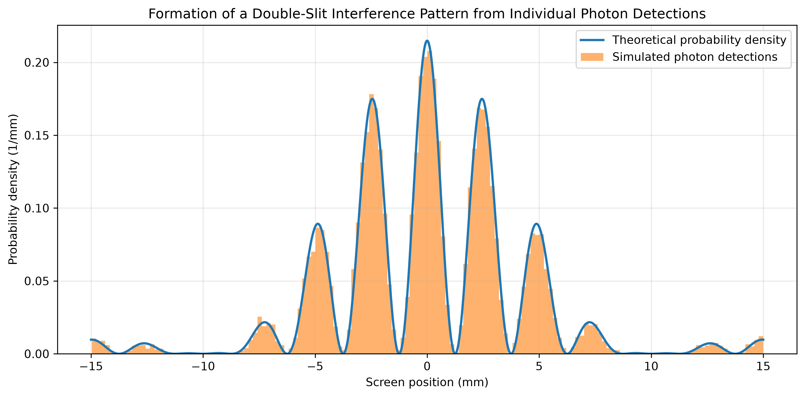
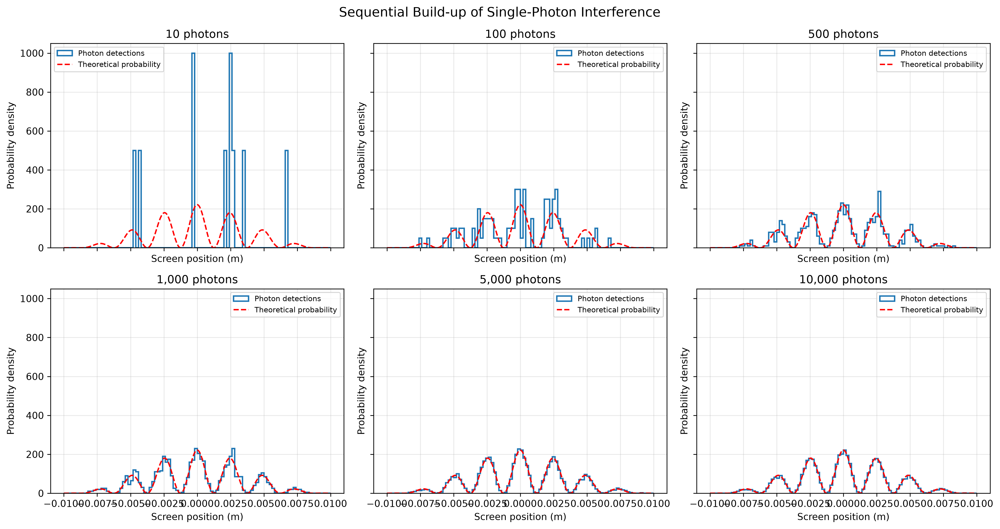
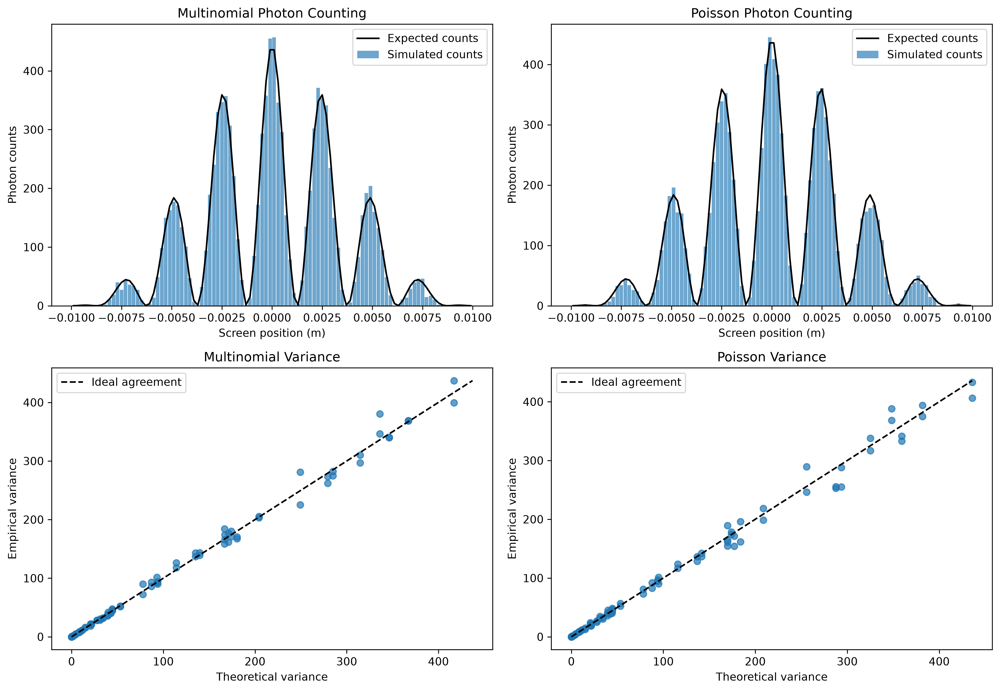

# Single-Photon Interference Simulator

A Python-based simulation of single-photon double-slit interference, including interference pattern formation, sequential photon detection, and photon counting statistics.

## Project Overview

This project investigates how individual photon detection events gradually build up an interference pattern in a double-slit experiment.

The simulation uses a wave-based probability distribution to generate individual photon detection positions and studies the statistical emergence of the interference pattern.

## Simulation Results

### Single-Photon Interference Pattern

The following figure shows the accumulated detection pattern generated from 10,000 simulated photons.

### Sequential Photon Detection

This simulation demonstrates how an interference pattern gradually emerges through the sequential detection of individual photons.

A single sequence of 10,000 photon detection events is generated. The cumulative detection distributions are examined after 10, 100, 500, 1,000, 5,000, and 10,000 detections.

The theoretical probability density is plotted alongside each cumulative histogram to illustrate the statistical emergence of the double-slit interference pattern.

### Photon Counting Statistics

This simulation compares two statistical models of photon detection: the multinomial distribution, where the total number of detected photons is fixed, and the Poisson distribution, where photon counts in individual detector bins fluctuate independently.

The simulation compares the measured photon counts and empirical variances with their theoretical predictions over 500 repeated experiments.

## Technologies

- Python
- NumPy
- SciPy
- Matplotlib
- Jupyter Notebook

## Project Status

The initial simulation framework has been implemented, including single-photon interference pattern formation, sequential photon detection, and photon counting statistics using multinomial and Poisson models.
